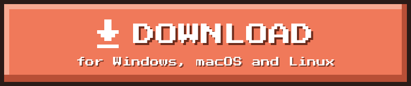
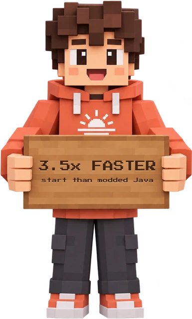
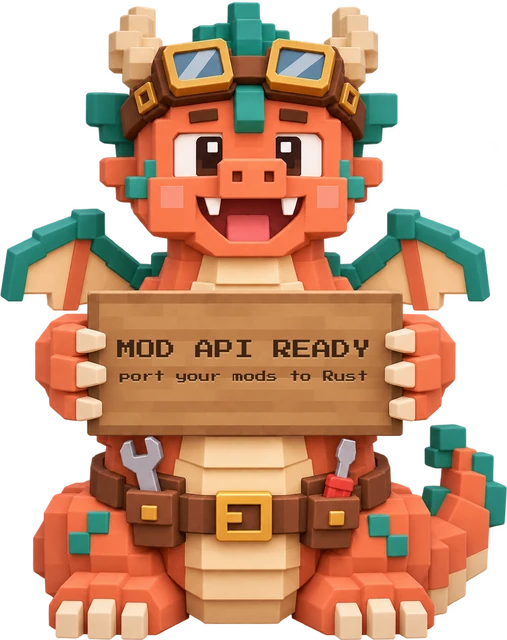

  

  <b>Minecraft: Java Edition 26.3, rebuilt from scratch in Rust.</b> 
  The same rules and the same terrain, your own worlds, in one native program without Java.

  

  
  
  
  

  <a href="https://playhorizon.dev"><b>Website</b></a> ·
  <a href="https://playhorizon.dev/docs/"><b>Docs</b></a> ·
  <a href="https://playhorizon.dev/docs/install"><b>Install guide</b></a> ·
  <a href="https://discord.gg/playhorizon"><b>Discord</b></a> ·
  <a href="ROADMAP.md"><b>Roadmap</b></a>

  

<table>
  <tr>
    <td width="50%" valign="top"> <b>Your worlds, the same rules</b> Survival, creative, hardcore and spectator. Vanilla saves open as they are.</td>
    <td width="50%" valign="top"> <b>Play together</b> Join vanilla and Horizon servers, open a world to LAN, or invite friends with a code.</td>
  </tr>
  <tr>
    <td width="50%" valign="top"> <b>See farther</b> Distant terrain up to 1,024 chunks, HDR and controller support.</td>
    <td width="50%" valign="top"> <b>Every dimension</b> Vanilla world generation, mobs, villagers, raids and redstone.</td>
  </tr>
  <tr>
    <td width="50%" valign="top"> <b>Mods in one click</b> Resource, data and shader packs, content mods and native Rust mods.</td>
    <td width="50%" valign="top"> <b>One launcher</b> Installs the game, keeps it up to date and hosts your server.</td>
  </tr>
</table>

  
  &nbsp;&nbsp;&nbsp;&nbsp;
  

  To the title screen in about 3 seconds, against about 11 for Java with Sodium, Lithium, FerriteCore and ImmediatelyFast.

<h2 align="center">Made by the Horizon Team</h2>

<table align="center">
  <tr>
    <td align="center" width="140"><a href="https://github.com/kacpherek"> <b>Kacper</b></a></td>
    <td align="center" width="140"><a href="https://github.com/Online5277"> <b>Cosmic</b></a></td>
    <td align="center" width="140"><a href="https://github.com/levzzz5154"> <b>levzzz</b></a></td>
    <td align="center" width="140"><a href="https://github.com/rdbtCVS"> <b>rdbt</b></a></td>
    <td align="center" width="140"><a href="https://github.com/dezer-x"> <b>Anthony S</b></a></td>
    <td align="center" width="140"><a href="https://github.com/ludovic111"> <b>Ludovic Marie</b></a> Founder</td>
  </tr>
</table>

  and everyone who has contributed  
  

  <a href="docs/native-client.md#run-from-a-checkout"><b>Build guide</b></a> ·
  <a href="CONTRIBUTING.md"><b>Contributing</b></a> ·
  <a href="GOVERNANCE.md"><b>Governance</b></a> ·
  <a href="https://discord.gg/playhorizon"><b>Discord</b></a>

Horizon is released under the [MIT licence](LICENSE) for the project's original work; dependencies keep their own licences, see the [notices](THIRD_PARTY_NOTICES.md). Founded by [Ludovic Marie](https://lu4ovic.com) and built by the Horizon Team and [its contributors](https://github.com/horizon-rust/horizon/graphs/contributors). You can support it on [GitHub Sponsors](https://github.com/sponsors/ludovic111).

NOT AN OFFICIAL MINECRAFT PRODUCT. NOT APPROVED BY OR ASSOCIATED WITH MOJANG OR MICROSOFT. Minecraft is a trademark of Mojang Synergies AB; its code and assets belong to Mojang and Microsoft under the [Minecraft EULA](https://www.minecraft.net/en-us/eula).
